<picture>
  <source media="(prefers-color-scheme: dark)" srcset="https://readme-typing-svg.demolab.com?font=Dancing+Script&weight=700&size=58&duration=2800&pause=100000&repeat=false&color=FAFAFA&center=true&vCenter=true&width=640&height=100&lines=Untara+Eka+Saputra" />
  
</picture>

 

&nbsp;&nbsp;

  

<code>FIG. 1.</code> Profile · Backend Developer &amp; Computer Networking

---

## STACK

<code>LANGUAGE &amp; FRAMEWORK</code> 
<picture>

  <source media="(prefers-color-scheme: dark)" srcset="https://skillicons.dev/icons?i=laravel,php,python,nextjs,js&theme=dark" />
  
</picture>

 

<code>DATABASE</code> 
<picture>

  <source media="(prefers-color-scheme: dark)" srcset="https://skillicons.dev/icons?i=mysql,postgres&theme=dark" />
  
</picture>

 

<code>CLOUD &amp; TOOLS</code> 
<picture>

  <source media="(prefers-color-scheme: dark)" srcset="https://skillicons.dev/icons?i=aws,git,github,linux&theme=dark" />
  
</picture>

---

## STATS

<code>FIG. 2.</code> GitHub activity · auto-updated from <a href="https://github.com/codewithun">@codewithun</a>

---

## SOCIAL LINKS

---

<code>untara eka saputra</code> · crafted with care · 

