---

## STACK

---

## STATS

<code>FIG. 2.</code> GitHub activity · auto-updated from <a href="https://github.com/codewithun">@codewithun</a>

---

## SOCIAL LINKS

---

<code>untara eka saputra</code> · crafted with care · 

